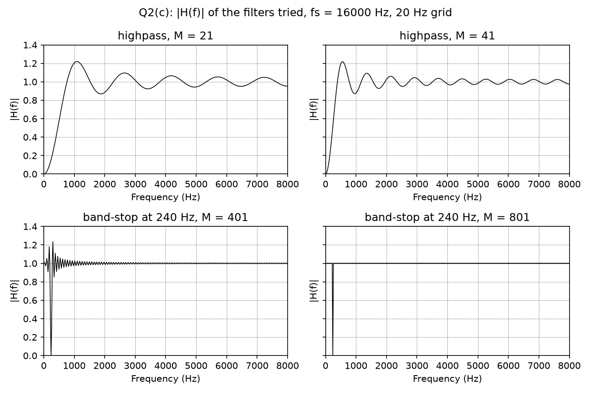

# Signals and Filters from Scratch

**EE229: Signal Processing I, IIT Bombay (Autumn 2026), Assignment 1**
Individual assignment under Prof. Satish Mulleti · Manas Jagtap

Sampling, aliasing, the DFT, sinc reconstruction and FIR filtering, all written directly from the formulas in Python. NumPy is used only for arrays and elementary functions, Matplotlib only for plots, and Python's built-in `wave` module only for reading and writing WAV files. **No `fft`, `conv`, `filter`, `freqz`, `sinc`, `unwrap` or noise-reduction function is used anywhere.**

## Results at a glance

| Question | What it does | Key result |
|---|---|---|
| Q1: Sampling and the DFT | DFT computed from the sum; sampling a 120 + 300 + 600 Hz signal at 4 kHz and 1 kHz | All six spectral lines recovered exactly at 4 kHz (other bins ~1e-14); at 1 kHz the 600 Hz tone aliases to 400 Hz, as predicted |
| Q2: Fan-noise removal from my own speech | 5 s of 16 kHz speech (80,000 samples) mixed with fan noise at 5 dB SNR; four FIR filters designed and compared | Linear-phase band-stop notch at 240 Hz (M = 801) raised SNR from **5.03 dB to 13.67 dB (+8.64 dB)**; fan energy down 10.6 dB |
| Q3: Sinc reconstruction | Finite sinc-sum interpolation with L = 2 to 128 | RMSE falls from **0.0259 to 0.00066**; below Nyquist the sum rebuilds the aliased 400 Hz signal (RMSE 0.0005 to it) |
| Q4: Filter phase | Pure delay vs first-order all-pass (a = 0.7) on speech; own phase-unwrapping routine | Both |H| = 1 to 4e-16; all-pass group delay rises from 0.18 to 5.67 samples across 0–8 kHz |

## Q2 in more detail

The fan noise turned out to be mostly a narrow hum at **240 Hz** (about 85% of its energy between 200 and 300 Hz), sitting right among the harmonics of my voice. I compared four filters, each written as an impulse response and evaluated from its own frequency-response sum:

| Filter | \|H\| at 240 Hz | \|H\| at 500 Hz | \|H\| at 1 kHz | ΔSNR |
|---|---|---|---|---|
| Highpass (centre minus local average), M = 21 | 0.155 | 0.572 | 1.203 | −1.60 dB |
| Highpass, M = 41 | 0.516 | 1.192 | 0.877 | +0.69 dB |
| Band-stop at 240 Hz, M = 401 | 0.002 | 0.934 | 1.005 | +6.12 dB |
| **Band-stop at 240 Hz, M = 801** | **0.001** | **1.002** | **0.998** | **+8.64 dB** |



The highpass filters cut the speech about as much as the noise. The cosine-weighted band-stop removes the hum almost completely while keeping gain ≈ 1 in the speech band. What's left is the broadband fan hiss, which overlaps the whole speech band and so can't be removed by any LTI filter without removing speech too.

Listen to the result in [`q2_audio/`](q2_audio): `q2_noisy_speech.wav` → `q2_filtered_speech.wav`.

## Repository layout

```
code/        q1.py … q4.py, one script per question
q2_audio/    Q2 inputs (my speech, fan noise) and all filtered outputs
q4_audio/    Q4 input and the delay / all-pass outputs
figures/     every plot, regenerated by the scripts
results/     printed output of each script (the numbers above)
report/      full written report (23 pages)
```

## Run it

```bash
pip install numpy matplotlib
cd code
python q1.py   # each script takes a few seconds and writes plots to ./figures
```
